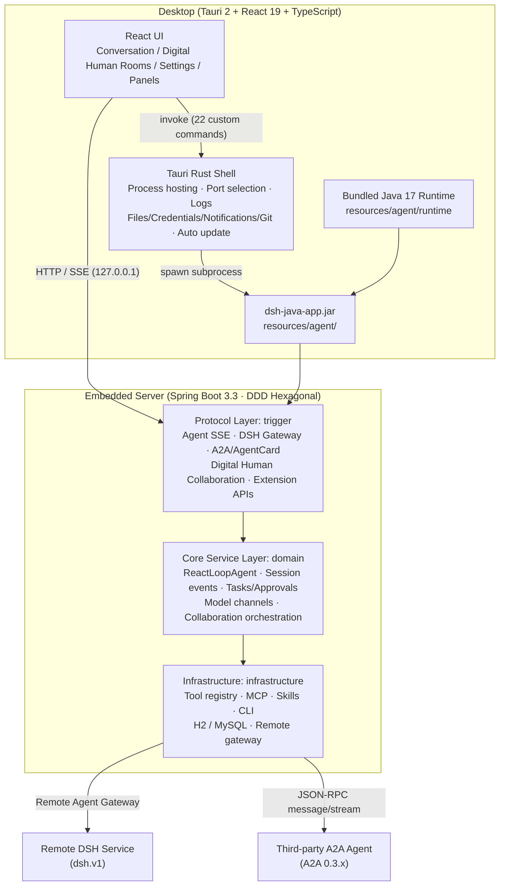
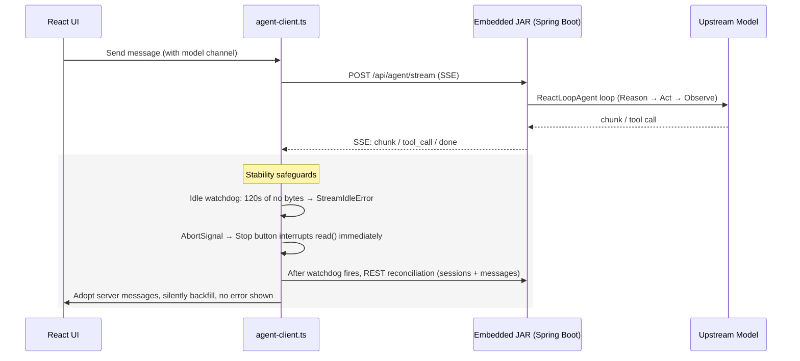
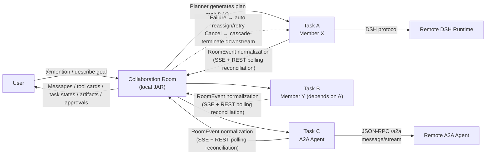

<div align="center">

# DSH Java Desktop

### Digital Human AI Agent Desktop · Built-in Agent Runtime · Digital Human Collaboration · A2A Open Protocol

[](./src-tauri/tauri.conf.json)
[](#-usage)
[](https://tauri.app)

</div>

> **TL;DR** · DSH Java desktop workbench: Tauri 2 + React 19, bundled agent runtime, digital-human collaboration and A2A protocol.
> **Keywords**: Desktop, Tauri, React, AI Agent, Digital Human, A2A, MCP
> **Repositories**: [dsh-java](https://github.com/linlannet/dsh-java) · [dsh-java-plugins](https://github.com/linlannet/dsh-java-plugins) · [dsh-java-mobile](https://github.com/linlannet/dsh-java-mobile) · [dsh-java-release](https://github.com/linlannet/dsh-java-release)
> **For AI**: [llms.txt](./llms.txt) · [AGENTS.md](./AGENTS.md)

> [**DSH Java Desktop**](https://mp.weixin.qq.com/s/1PVow3-HvItfUvSReGt6wQ) is the desktop workbench for [dsh-java](https://t.zsxq.com/kYcVt) (the Agent Runtime server). It is a ready-to-use desktop client for "digital human" AI agents — with the DSH Java Agent Runtime built in, it works out of the box with zero external dependencies. A single digital human handles coding, drawing, document work and more, while multiple digital humans can team up across devices via dsh.v1 / A2A. Plugins, Skills, MCP and CLI extend it on demand.
>
> The desktop app is only the shell; capabilities live on the server side: **TypeScript + React** builds the UI, **Tauri 2** handles the window, process hosting and native capabilities, while the agent capabilities are implemented by `dsh-java`. The desktop shell launches the embedded Spring Boot JAR and talks to it over the local `127.0.0.1` HTTP/SSE API (this is also the best way for the shell to quickly integrate remote agents).

---

## 📑 Table of Contents

- [Usage](#-usage)
- [How It Works](#%EF%B8%8F-how-it-works)
- [Core Features](#-core-features)
- [Tech Stack](#%EF%B8%8F-tech-stack)
- [Project Structure](#-project-structure)
- [Releases & Auto Updates](#-releases--auto-updates)
- [Diagnostics & FAQ](#-diagnostics--faq)
- [Related Docs](#-related-docs)

---

## 🚀 Usage

### Option 1: Install from Installer (recommended for personal use)

#### 1. Download the installer

Download the installer for your platform from GitHub Releases:

- GitHub: [https://github.com/linlannet/dsh-java-desktop/releases](https://github.com/linlannet/dsh-java-desktop/releases)

| Platform | Architecture |
|:---|:---|
| macOS | Apple Silicon / Intel |
| Windows | x64 |
| Linux | x64 |

> Feature introduction: [https://mp.weixin.qq.com/s/1PVow3-HvItfUvSReGt6wQ](https://mp.weixin.qq.com/s/1PVow3-HvItfUvSReGt6wQ) — the latest version keeps iterating; download and try it out.

#### 2. Launch and go

The app automatically starts the built-in agent service on launch (no JDK / database required — the release bundles Temurin JRE 17 and a local H2, with data stored in the app data directory).

#### 3. Confirm the service is ready

Open "Settings" in the bottom-left corner → "Agent Service Connection" to confirm the service is ready.

#### 4. Configure a model

1. Pick a channel template, then fill in the Base URL and API Key;
2. Click "Sync Models" to fetch the upstream model list, or type a model code directly;
3. Click "Save Model" — the desktop app stores the `channelCode` returned by the server and activates it immediately;
4. The model selector at the top then shows the runtime model, which is sent with the channel on every message.

If the model is configured correctly but the upstream is unavailable, the conversation area shows the error returned by the agent; the desktop process itself does not crash.

#### 5. Start chatting

Chat directly in a project/session; you can also have the agent generate Word / Excel / Markdown / ECharts / draw.io artifacts, or invite more digital humans to form a collaboration team (see below).

### Option 2: Run from Source (recommended for developers)

```bash
npm install          # If "Failed to resolve import" appears on a new machine or after pulling new code, run this first
npm run tauri dev
```

During development, if there is no JAR under `resources/agent/`, the Rust layer falls back to `../dsh-java/dsh-java-app/target/dsh-java-app.jar` (Maven finalName, no version suffix).

To build a release package (automatically: build server JAR → copy → download JRE 17 for the current platform):

```bash
npm run tauri:build
```

To prepare the runtime for cross-platform builds:

```bash
DSH_JRE_TARGET=darwin-arm64 npm run agent:runtime
DSH_JRE_TARGET=win32-x64 npm run agent:runtime
```

> If the bundled runtime in a release build is missing, corrupted, or older than 17, the settings page shows the exact Java path, version and error reason; an official build missing the runtime prompts you to prepare resources up front and never silently falls back to the system Java.

---

## ⚙️ How It Works

The core design decision of this project is "**the desktop app is only the shell; capabilities live on the server side**":

1. **Agent capabilities are embedded, not rewritten**. `dsh-java-app.jar` (Spring Boot, DDD hexagonal architecture) is bundled into the installer as a Tauri bundle resource (`resources/agent/`). The ReactLoopAgent main loop, session event sourcing, tool registration and execution, task queues, permission approval, model channel management and the digital human collaboration domain are all implemented server-side; the desktop app only projects the UI.
2. **standalone profile + local H2**. Zero external dependencies for desktop scenarios — no MySQL deployment required; data lands in the app data directory.
3. **Rust layer hosts the process**. The Tauri Rust layer picks a free port, starts/stops the JAR subprocess, captures logs and records runtime state (`<app-data-dir>/agent-runtime.json`); after an abnormal exit, the next launch cleans up leftover JAR processes first to avoid H2 file-lock conflicts. The frontend exposes no command-execution attack surface.
4. **Bundled Java 17 Runtime**. Release builds use the bundled Temurin JRE 17 (`resources/agent/runtime`, downloaded per-platform by the prepare script). Users never need to install or configure a JDK, and the app never touches the user's `JAVA_HOME` / `PATH`. In development, Java is resolved in the order `DSH_AGENT_JAVA` → bundled runtime → system `java`, with the version required to be ≥ 17.
5. **Local loopback communication**. The desktop UI only talks to the service over `127.0.0.1`; the local port never enters the main conversation area and is only surfaced as diagnostics in the settings page.
6. **Tauri native capabilities complete the desktop experience**. Local file read/write/preview/context menus, directory/file pickers, secure credential storage, system notifications, Git branch viewing and switching, auto updates and more are provided by 22 custom Rust commands.
7. **Open protocols connect remote agents**. The server implements the DSH v1 Agent Card (`/.well-known/dsh-agent-card`) and the standard **A2A 0.3.x** protocol (`/.well-known/agent-card.json` + JSON-RPC `/a2a` endpoint). Remote DSH / A2A services can both be discovered and onboarded as digital humans, collaborating with local agents in the same room.

### Overall Architecture



### Conversation Streaming Pipeline (with stability safeguards)



### Digital Human Collaboration Pipeline



### Key Stability Designs

The digital human streaming pipeline has gone through several rounds of fixes for "permanently stuck while generating". The current safeguard system:

| Layer | Mechanism | Description |
| --- | --- | --- |
| Agent conversation stream | Idle watchdog | 120s with no bytes forces an interrupt (SSE may go silent during long tool executions, so it cannot be set too small) |
| Agent conversation stream | AbortSignal interrupt | Stop button / watchdog can immediately interrupt a pending `reader.read()` |
| Agent conversation stream | REST reconciliation fallback | After an interrupt, sessions and messages are fetched by agentId, compared with and adopted from the server, silently backfilled |
| Room event stream | Exponential backoff reconnect | Auto reconnect from 1s capped at 15s, resuming via `afterSeq` from the latest seq (server auto-replays backlog) |
| Room event stream | Idle watchdog | 10 minutes (idle room streams are normal; the server SseEmitter has no heartbeat) |
| Room event stream | Runtime reconciliation polling | While tasks are running, events are re-fetched and snapshots refreshed every 5s, not relying on SSE staying alive |
| Server | Complete cancel semantics | Task registry + FutureTask cancellation + state never overwritten + downstream cascade set to FAILED |
| Server | Automatic failure recovery | 1 recovery budget per task: reassign first (same capability tags preferred), retry with the same member if no candidate, cascade-terminate only when exhausted |
| Server | Tool timeout | `harness.agent.tool-timeout-ms` (default 300s, ≤0 disables) prevents a stuck tool from blocking the whole turn |
| Server | SSE heartbeat | All SSE streams send a unified 15s `:keepalive` comment heartbeat to survive NAT/proxies |

---

## 🎯 Core Features

### 💬 Conversation & Workspace

- Project/workspace management (with multiple sub-projects), session management (pinning, custom titles, cross-project drag & drop and sorting, order persistence)
- Streaming messages (SSE), Markdown/GFM rendering (tables, task lists, footnotes, code highlighting), stop generation
- Sidebar search box, filter popover (status all/running/unread/pinned, time all/today/7d/30d), "Conversations/Projects" list mode toggle, collapse
- Agent-initiated questions (ask_user_question): while streaming, the agent can ask multiple-choice or free-form questions; a Q&A card renders above the input box, and answering wakes the agent to continue
- Runtime tool calls are handled by compact prompt bars in the conversation area, allowing/denying (tool approval)

### 📁 File Artifacts & Preview

- Inline file cards in messages: icons and colors by extension, code files viewable with line numbers
- Context menu: Open / Open Folder / Save As / Copy Path; directory cards open directly in the file manager
- Relative paths resolve against the current project root; invalid paths are grayed out and marked "Not Found"
- **Diff Viewer (DiffView)**: view change diffs for file artifacts in messages
- **Directory Tree Viewer (DirTreeView)**: visual browsing of the workspace directory structure

### 🧩 Resource Plugins

Five built-in resource types, each with its own icon and preview:

| Plugin | Artifact | Preview |
| --- | --- | --- |
| Word | .docx document | Text preview |
| Excel | .xlsx spreadsheet | Table preview |
| Markdown | .md document | Markdown rendering |
| ECharts | Charts | ECharts rendering |
| draw.io | .drawio diagram | Embedded diagrams.net preview and editing (edits auto-save to disk with an 800ms debounce; requires internet access to embed.diagrams.net — offline shows a notice without affecting file contents) |

### 🤖 Digital Human Collaboration

- **Digital human catalog**: three source types — local DSH / remote DSH / A2A. The add wizard auto-detects the Agent Card under `/.well-known/` (both DSH v1 and A2A 0.3.x protocols) and pre-fills name, purpose and capabilities
- **Collaboration rooms**: invite digital humans into a conversation, dispatch with `@member`, or simply describe the goal and let the Planner auto-split it into a task DAG
- **Task orchestration**: independent tasks run in parallel; dependent tasks automatically continue once upstream artifacts are ready
- **Directed Q&A (ASK protocol)**: members can ask targeted questions mid-execution; replies are injected as instructions and execution resumes automatically
- **Automatic failure recovery**: 1 recovery budget per task — reassign first (same capability tags preferred), retry with the same member if no candidate, cascade-terminate downstream only when exhausted
- **Task cancellation**: cascade-terminates downstream tasks with complete cancel semantics
- **Visualization**: tool calls and artifacts are visible in real time in both the conversation stream and the right-side collaboration panel; dangerous operations go through approval prompt bars

### 🔌 Model Integration

- Channel templates, Base URL + API Key configuration
- Sync upstream model lists, activate/delete models, switch runtime models

### 🧰 Extensions (Skills / MCP / CLI)

Managed centrally in Settings → "Extensions":

| Type | Supported Operations |
| --- | --- |
| Skills | Install from Git repositories (local path or remote Git), enable/disable, delete |
| MCP Servers | Add/edit/delete (stdio and other transports), auto connection test and tool discovery before save, hot connect/disconnect at runtime |
| CLI Commands | Configure claude / codex (hot reload) and acp subagents (restart required) |

Extension configuration persists at `~/.dsh/extensions.json`; 6 `extension_*` conversation tools are also registered, so you can say "install this skill for me" in a conversation and have the agent do it. MCP configs can override presets with the same name (custom takes precedence over same-named presets).

### 📊 Runtime Info Panel

The right info rail shows the Git status of the current workspace and its sub-projects: branches are viewable in a dropdown and switchable directly (runs `git checkout`), plus workspace change viewing. Multi-project workspaces are listed per sub-project.

### 🖥️ Desktop Experience

- System notifications (when the session is unfocused), conversation completion sounds (Web Audio synthesized, distinct success/failure tones)
- Sidebar resizing, collapse, global error boundary (render errors no longer white-screen)
- Auto update (Tauri updater + GitHub Releases; checks on startup, one-click download, install and restart when a new version is found)

---

## 🏗️ Tech Stack

| Layer | Technology | Version |
|:---|:---|:---|
| Frontend | React + TypeScript + Vite + react-markdown + highlight.js | 19 / 5.x / 7 |
| Desktop shell | Tauri 2 + Rust (process hosting · files/credentials/notifications/Git · 22 custom commands) | 2.x |
| Server | dsh-java (Spring Boot · DDD hexagonal · ReactLoopAgent · event sourcing) | 3.3 |
| Resource plugins | ECharts + mammoth + xlsx + react-drawio | 6 / 1.x / 0.18 |
| Bundled runtime | Temurin JRE 17 (packaged per platform, `resources/agent/runtime`) | 17 |
| Database | H2 (standalone profile, zero external dependencies) | — |
| Packaging | Tauri bundler (dmg / msi / AppImage, etc.) | 2.x |

---

## 📁 Project Structure

```text
dsh-java-desktop/
├── src/                            # React frontend
│   ├── App.tsx                     # App main container (sessions/projects/streaming/reconciliation)
│   ├── components/                 # UI components (28)
│   │   ├── ConversationView.tsx    # Conversation view (streaming messages/tool approvals/Q&A cards)
│   │   ├── Sidebar.tsx             # Sidebar (search/filter/sort/collapse)
│   │   ├── RoomCollaborationView.tsx # Digital human collaboration room view
│   │   ├── DigitalHumanCatalog.tsx # Digital human catalog
│   │   ├── AddDigitalHumanWizard.tsx # Add digital human wizard (Agent Card detection)
│   │   ├── DigitalHumansSettings.tsx # Digital humans settings page
│   │   ├── ExtensionsSettings.tsx  # Extensions settings (Skills/MCP/CLI)
│   │   ├── PluginsSettings.tsx     # Resource plugin settings
│   │   ├── SettingsView.tsx        # Settings center (models/service connection/extensions)
│   │   ├── QuestionCard.tsx        # Agent-initiated question card
│   │   ├── ApprovalCard.tsx        # Tool approval card
│   │   ├── ArtifactPreview.tsx     # Artifact preview panel
│   │   ├── FilePreview.tsx         # File preview (code with line numbers)
│   │   ├── DiffView.tsx            # Diff viewer
│   │   ├── DirTreeView.tsx         # Directory tree viewer
│   │   ├── DrawioPreview.tsx       # Embedded draw.io editor
│   │   ├── EChartBlock.tsx         # ECharts chart block
│   │   ├── InfoRail.tsx            # Runtime info panel (Git branches/changes)
│   │   ├── CollabPanel.tsx         # Collaboration panel
│   │   ├── GroupChatView.tsx       # Group chat view
│   │   ├── ErrorBoundary.tsx       # Global error boundary
│   │   └── ...
│   ├── lib/                        # Client utility library
│   │   ├── agent-client.ts         # Agent HTTP/SSE client (with stability safeguards)
│   │   ├── digital-human-client.ts # Digital human client (dual-protocol detection)
│   │   ├── room-feed.ts            # Room event stream (reconnect/resume/reconcile)
│   │   ├── room-chat.ts            # Room chat
│   │   ├── http.ts                 # HTTP wrapper
│   │   ├── react-drawio/           # Embedded draw.io component
│   │   ├── markdown-plugins.ts     # Markdown/GFM plugins
│   │   └── sound.ts                # Completion sounds
│   ├── types.ts                    # Type definitions (incl. resource plugin kinds)
│   └── styles.css                  # Global styles
├── src-tauri/                      # Tauri Rust shell
│   ├── src/lib.rs                  # 22 custom commands + process hosting + updates
│   └── tauri.conf.json             # Tauri configuration
├── resources/agent/                # Embedded server JAR + Java 17 Runtime (not in Git)
├── scripts/
│   ├── prepare-runtime.mjs         # Download Temurin JRE 17 per platform
│   └── tauri-build-here.sh         # Local build helper script
├── tests/                          # E2E and unit tests
│   ├── browser-stub-init.js        # Browser stub (fake invoke/fetch)
│   ├── harness/                    # E2E runner and fake-llm
│   ├── unit/                       # vitest unit tests
│   └── cases/                      # E2E case list
├── docs/                           # Architecture/design docs + visual overview page
└── data/                           # Local data
```

Companion server project: `../dsh-java` (sibling directory). **After changing the server, you must rebuild the JAR and overwrite `resources/agent/dsh-java-app.jar`** (`npm run agent:prepare` does it in one step) before the desktop app picks up the new server.

---

## 🚢 Releases & Auto Updates

The four platforms trigger builds independently via their own tags; on success, installers and Tauri updater signature files are uploaded to the corresponding `dsh-java-desktop-v*` GitHub Release:

| Platform | Tag |
| --- | --- |
| Linux x64 | `linux-x64-v*` |
| Windows x64 | `windows-x64-v*` |
| macOS Apple Silicon | `macos-apple-silicon-v*` |
| macOS Intel | `macos-intel-v*` |

The app checks for updates at the following endpoint (auto-check on startup; when a new version is found, one-click download, install and restart):

```text
https://github.com/linlannet/dsh-java-desktop/releases/latest/download/latest.json
```

CI requires the following in the repository `Settings → Secrets and variables → Actions`:

| Secret | Purpose |
| --- | --- |
| `TAURI_SIGNING_PRIVATE_KEY` | Private key for signing Tauri auto-update packages |
| `TAURI_SIGNING_PRIVATE_KEY_PASSWORD` | Signing private key password; may be empty if none |
| `APPLE_CERTIFICATE` | Base64 content of the macOS Developer ID Application `.p12` certificate |
| `APPLE_CERTIFICATE_PASSWORD` | Password of the above `.p12` certificate |
| `APPLE_SIGNING_IDENTITY` | macOS code signing identity name |
| `APPLE_ID` | Apple ID used for macOS notarization |
| `APPLE_PASSWORD` | App-Specific Password used for macOS notarization |
| `APPLE_TEAM_ID` | Apple Developer Team ID |

`GITHUB_TOKEN` needs no manual setup. The updater private key lives at `src-tauri/updater.key`; the public signing key is already embedded in `src-tauri/tauri.conf.json`.

---

## 🩺 Diagnostics & FAQ

**Log location**: `<app-data-dir>/logs/agent.log` (on macOS: `~/Library/Application Support/net.linlan.desktop/logs/agent.log`). The actual HTTP port of the embedded service follows the log line "Web console ready: http://localhost:\<port\>/". For stuck-stream issues, check the logs first, then `curl` `127.0.0.1:<port>/api/agent/stream` directly to distinguish server-side from frontend issues.

**Build fails with `Permission denied (os error 13)` after replacing the JAR / large files**: the cached copy under `src-tauri/target/debug/agent/` is read-only — delete that cache directory and rebuild; do not wipe the whole `target`.

**`tauri dev` reports `Port 1420 is already in use` / leftover processes**: the npm wrapper exiting does not mean the app exited — the window, embedded java and vite often survive as orphans. For a clean restart: kill leftover `dsh-java-desktop`, `java`, and vite (node:1420) processes before starting.

**Lost context caused by stale session IDs**: localStorage may still hold `collab-<ts>` prefixed session IDs from older builds, making the server create a new agent every time; delete the corresponding sessions or clear localStorage.

**draw.io won't open**: the embedded editor needs internet access to embed.diagrams.net; offline shows a notice but file contents are unaffected.

**Stop only disconnects the frontend**: currently stopping only interrupts SSE reading and frontend rendering; the server-side agent finishes the current turn (idling in the background). Full cancellation requires a server-side interrupt API (task cancellation in collaboration rooms already has complete semantics).

---

## 📚 Related Docs

- [Changelog](CHANGELOG.md) — version history and change records
- [Local Startup Guide](docs/本地启动指南.md) — complete steps to run the desktop app from scratch locally
- [Digital Human Collaboration Architecture](docs/0.2.2/architecture/digital-human-agent-architecture.md) — digital human domain model, collaboration mechanisms, event protocols, evolution roadmap
- [Digital Human Implementation Notes](docs/0.2.2/design/digital-human-implementation.md) / [Roadmap](docs/0.2.2/design/digital-human-roadmap.md)
- [Architecture Overview (visual)](docs/overview.html) — visual version of the architecture diagram + usage guide
- [Architecture Diagram Source (draw.io)](../dsh-java/docs/md/draw.io/dsh-java-architecture.drawio) — full server architecture diagram
- Server project: [dsh-java](https://github.com/linlannet/dsh-java) (Spring Boot 3.3 · DDD hexagonal · ReactLoopAgent · event sourcing · plugins/MCP/Skills/CLI extension system)

---

<div align="center">
  <sub>Built with ❤️ by the DSH Java Desktop community</sub>
</div>
